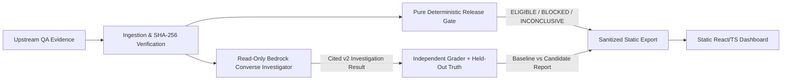
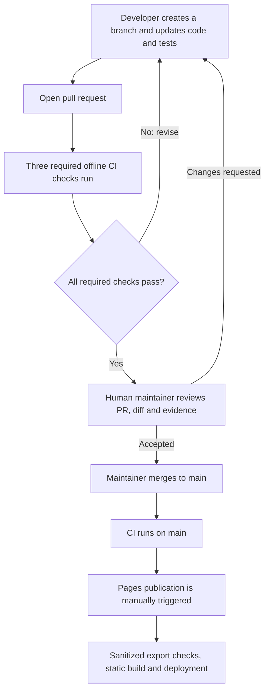

# QualityOps AI

**Evidence-Driven Release Gates and Evaluated, Read-Only AI Failure Investigation**

QualityOps AI is a reproducible engineering showcase that separates **deterministic release eligibility** from **advisory AI failure investigation**, then evaluates AI investigations offline and live against held-out ground truth.

> **Project status:** The static dashboard is published at [camiloavilacm.github.io/QualityOps-AI](https://camiloavilacm.github.io/QualityOps-AI/) and serves sanitized, recorded data. Publication is manually triggered. The dashboard does not call AWS or incur model costs.

## Start Here

To look around the dashboard, you need Node.js 22 or newer and npm. From the repository root:

```sh
npm --prefix frontend ci
npm --prefix frontend run dev -- --port 4173
```

Open <http://127.0.0.1:4173/>. Select the sample campaigns to see `ELIGIBLE`, `BLOCKED`, and `INCONCLUSIVE` decisions, recorded investigation examples, evidence links, and the evaluation view at `/?view=evaluation`. These are synthetic or previously recorded examples; the dashboard does not connect to your test systems, execute your tests, or invoke a model. Press Ctrl+C in the terminal to stop the local server.

### What to Expect

- **A demonstration of the evidence flow:** validated campaign records feed a deterministic gate; AI investigation results are shown separately and cannot change that decision.
- **A recorded benchmark that did not qualify its candidate:** the live evaluation is included as evidence, and its promotion decision is **blocked** because it missed diagnosis and abstention thresholds. This is an example of the evaluator refusing promotion, not a recommendation to deploy that model.
- **Offline by default:** browsing the dashboard and running the ordinary local checks do not require AWS credentials or Bedrock access. The separate live-evaluation workflow is explicitly triggered, restricted, and may incur model charges.
- **No automatic release or test repair:** Planner, Generator, and Healer examples assist test authoring in a disposable workspace. A person reviews proposals; CI runs the reviewed tests. The investigator is read-only, and there is no auto-merge or automatic deployment.

## Core Capabilities

1. **Versioned Evidence Ingestion (`backend/ingestion/`)** — Validates frozen v2 JSON schemas (Draft 2020-12), verifies SHA-256 digests against artifact bytes, enforces idempotent re-imports, rejects conflicting IDs and tampering, and preserves upstream provenance.
2. **Pure Deterministic Release Gate (`backend/gate/`)** — Pure function of validated evidence and versioned policy with zero AI, evaluator, or network dependencies. Emits `ELIGIBLE`, `BLOCKED`, or `INCONCLUSIVE` (`BLOCKED > INCONCLUSIVE > ELIGIBLE`) while preserving all applicable reason codes (`REQUIRED_FAILURE` and `INSUFFICIENT_EVIDENCE` together on mixed campaigns).
3. **Read-Only AI Failure Investigator (`backend/investigator/`)** — Uses raw Amazon Bedrock Converse (no agent framework) with a single allowlisted, bounded `read_evidence` tool, strict prompt-injection and canary-redaction controls, token/timeout/cost caps (`<= $0.10` / `<= 20s`), and safe fail-closed `ERROR` handling that cannot alter the release gate.
4. **Independent Ground-Truth Evaluation (`evaluators/`)** — Deterministic grader (`v1.2.0`) over a 20-case held-out corpus (`v1.1.0`: 15 seeded defects, 3 insufficient-evidence, 2 intermittent/flaky) reporting diagnosis accuracy, citation validity, claim support, abstention, invalid outputs, safety violations, `pass@3` / `pass^3`, latency, cost, and `SPEC.md` §9 promotion checks.
5. **Static Presentation Dashboard (`frontend/`)** — React + TypeScript SPA reading only sanitized, allowlisted JSON exports (`mixed-campaign.json`, `showcase-export.json`, `live-evaluation.json`) with zero live API or AWS credentials.

## Architecture



See [docs/architecture.md](docs/architecture.md) and [docs/threat-model.md](docs/threat-model.md) for trust boundaries, data flows, and OWASP 2025 LLM security controls.

## Verified Results

| Verification | Scope | Outcome | Evidence |
|---|---|---|---|
| **Offline CI** | A1 (`32`), B2 (`12`), B1 (`15`), Stage 2 vertical slice (`4`), export checks, Vite build | **PASS** (`63/63` tests) | [.github/workflows/ci.yml](.github/workflows/ci.yml) |
| **Offline OWASP 2025 Review** | Independent read-only review of B1/B2 retrieval, safety, and grading | **PASS** | [harness/offline-review.md](harness/offline-review.md) |
| **Playwright Dashboard Exercise** | Planner/Generator/Healer, two disposable UI variants, and matched CLI/MCP/WebMCP checks | **PASS**; evidence merged in [PR #15](https://github.com/camiloavilacm/QualityOps-AI/pull/15) | [Current review](harness/playwright-review.md#current-main-replay-2026-11-26), [evidence packet](harness/artifacts/playwright-dashboard-exercise-20261126/summary.json) |
| **PR Verification Harness** | Four cumulative isolated-container gates, guardrails, mutation canary, WebMCP checks, offline red-team suite | **PASS**; independently reviewed and merged in [PR #9](https://github.com/camiloavilacm/QualityOps-AI/pull/9) | [Harness plan](docs/pr-verification-webmcp-harness-plan.md), [implementation record](harness/container/implementation-record.json) |
| **Live Bedrock Benchmark** | 120 sequential live trials in `eu-west-1` (`Nova Lite` baseline vs. `Claude Haiku 4.5` candidate, `60/60` measured on both, total spend `$0.1696`) | **Completed — Promotion Blocked (`threshold_status: fail`)** | [frontend/src/live-evaluation.json](frontend/src/live-evaluation.json) |

The dashboard exercise was a host development run; it is separate from the isolated-container PR verification gates. CLI and MCP each confirmed the mixed campaign's `BLOCKED` decision and both reason codes. Their token use was **unmeasured**. WebMCP discovery, valid and invalid campaign lookups, and agreement with the displayed summary were checked in the disposable exercise workspace. The human-approved repair changed only the locator; that locator is already present in the reviewed main test. The unchanged test still caught the dropped-reason regression on its first attempt. The full generated spec was not promoted. See the [current review record](harness/playwright-review.md#current-main-replay-2026-11-26) and [evidence packet](harness/artifacts/playwright-dashboard-exercise-20261126/summary.json) for the source of truth, environment, commands, reviewer caveats, and artifacts.

### PR Verification and WebMCP Safeguards

The staged harness runs candidate verification inside a trusted Linux/amd64 container with pinned dependencies and Chromium. Its cumulative gates cover ordinary browser tests, production error guards, exact test discovery and assertion hygiene, an isolated paired mutation canary, the Python contract/export checks, offline red-team cases, and bounded read-only WebMCP summary tools. Candidate source and bundles are read-only during execution; the runner records revisions, digests, commands, results, and cleanup. The WebMCP tools expose only projections of sanitized recorded exports and do not invoke models, retrieve private evidence, or mutate dashboard state.

Stages 1–4 were independently reviewed, accepted, and merged. The exact-SHA Gate 4 run passed; CI passed `python-contracts-and-eval`, `frontend-e2e`, and `frontend-webmcp`. The authored-evaluation oracle received a separate independent PASS review and is kept out of browser assets and model/tool inputs. All 13 local red-team cases passed. The active `main` ruleset requires pull requests and all three checks with no bypass actors; remote enforcement checks R12 and R14 passed on a temporary target. The review found no basis to treat these controls as automatic release approval: the deterministic gate remains independent of the investigator, and Pages publication remains a separate manually triggered action.

See the [Stage 4 implementation record](harness/container/implementation-record.json) for exact verifier, runtime-policy and acceptance-record digests, and the [remote enforcement summary](harness/artifacts/h1-remote-enforcement-20261125/summary.json) for H1 evidence.

### Where Tests Come From

Acceptance criteria and some source evidence are referenced from the pinned, read-only `qa-features` repository. This repository contains the implementation tests and synthetic campaign fixtures used to check those criteria:

- `samples/` contains recorded campaign/evidence fixtures and expected decisions.
- `backend/ingestion/`, `backend/gate/`, and `backend/investigator/` contain Python tests alongside their modules.
- `evaluators/` contains model-visible cases, separate held-out labels, deterministic graders, and offline replay tests.
- `tests/test_vertical_slice.py` checks the components together across an end-to-end recorded-evidence path.
- `frontend/tests/` contains Playwright browser tests; `frontend/tests/meta/` covers browser error guards and WebMCP lifecycle behavior.
- `harness/` contains contract, report, policy, red-team, and isolated-runner checks.

The Playwright Test Agent definitions are in `frontend/.codex/agents/`, and the dashboard exercise plan is in `frontend/specs/`. Planner/Generator output and Healer proposals are reviewed before any test change is accepted. The mixed-campaign agent exercise ran in a disposable workspace; PR #15 records its evidence. It did not add autonomous test generation or repair to CI.

### Augmentation, Automation, and Agentic Testing

| Mode | Meaning | How this project uses it |
|---|---|---|
| **Augmentation** | AI assists a person by drafting or explaining; a person checks the result and decides what to keep. | Planner drafts a test plan, Generator drafts a Playwright spec, Healer proposes a locator repair, and the investigator offers cited failure analysis. These are suggestions, not test verdicts or release decisions. |
| **Automation** | Code runs predefined checks against fixed expectations without an AI choosing the next step. | GitHub Actions runs the Python, contract, export, Playwright, WebMCP, and harness checks for a pull request. The deterministic gate also computes release eligibility from validated evidence and policy. |
| **Agentic** | An AI follows a multi-step loop: it observes, chooses an allowed tool/action, inspects the result, then continues or stops. | The disposable Planner/Generator/Healer exercise used this pattern during test authoring. The runtime investigator can make bounded, read-only evidence requests. Neither can change the gate, edit product code, merge a PR, or deploy. |

These modes can work together: agentic tooling may augment test authoring, while conventional automation runs the reviewed tests. In this repository, AI-generated or healed tests do not run in CI and are never accepted without human review.

### What the Test Types Mean Here

| Test type | Where it lives | What it checks |
|---|---|---|
| **Unit and policy** | `backend/ingestion/test_importer.py`, `backend/gate/test_gate.py`, investigator tests, `evaluators/test_evaluate.py` | Individual validators, digest and identity rules, pure gate decisions, bounded evidence reads, and deterministic grading. |
| **Contract and integrity** | `contracts/v2/`, `samples/`, `harness/checks.py`, ingestion tests | Schema validity, provenance, tampering rejection, duplicate-import behavior, completeness, and expected gate outcomes. |
| **Integration / vertical slice** | `tests/test_vertical_slice.py` | Connects validated campaign evidence, the independent gate, investigation/evaluation records, and sanitized dashboard exports. |
| **Functional / browser end-to-end** | `frontend/tests/` | Opens the dashboard and verifies user-visible gate states, reason codes, investigations, evidence links, evaluation views, and WebMCP summaries. |
| **Smoke-style browser check** | `frontend/tests/seed.spec.ts` | Confirms the dashboard boots, its campaign cards and navigation appear, and there are no page or console errors. This is part of the Playwright suite, not a post-deployment production smoke test. |
| **Security and negative-path** | `backend/investigator/test_retrieval.py`, `frontend/tests/meta/`, `harness/` | Prompt injection, redaction, unauthorized reads, malformed outputs, browser error handling, test-scope hygiene, and an isolated mutation canary that must catch a dropped missing-evidence reason. |
| **AI evaluation** | `evaluators/` and protected `live-eval.yml` workflow | Separately grades diagnosis, citation validity/support, abstention, safety, latency, and cost. Offline replay is routine; live Bedrock evaluation is a separately authorized, potentially billable workflow. |

There is no general load/performance test suite. The live model benchmark records inference latency and cost, but does not measure application throughput. CI does not call Bedrock. The dashboard exercise's CLI/MCP/WebMCP runs are recorded development evidence, not a production-browser test.

### From a Code Change to Production



The CI checks are `python-contracts-and-eval`, `frontend-e2e`, and `frontend-webmcp`; the `main` ruleset requires a pull request and all three checks. Human review is routed to the repository owner through [.github/CODEOWNERS](.github/CODEOWNERS), and the project process requires a maintainer to decide whether to merge. **The current ruleset sets required approving reviews to zero**, however, so it does not technically block a merge that has green checks but no submitted approval. The human review is a process requirement today, not an enforced branch-protection approval count.

**GitHub Pages publication is authorized and enabled** through [PR #11](https://github.com/camiloavilacm/QualityOps-AI/pull/11). The manually triggered [.github/workflows/pages.yml](.github/workflows/pages.yml) checks sanitized exports, builds the static dashboard, uploads the Pages artifact, and deploys it. Merging to `main` does not publish automatically. The live static dashboard is at [camiloavilacm.github.io/QualityOps-AI](https://camiloavilacm.github.io/QualityOps-AI/); it serves sanitized recorded data. Deployment and live asset verification are recorded in [harness/container/implementation-record.json](harness/container/implementation-record.json).

Live Bedrock evaluation is a separate manual workflow restricted to `main` and its protected environment; it is not a deployment step or a normal PR check. It must be explicitly authorized because it invokes paid models.

### Live Benchmark Summary (120 Sequential Trials, `eu-west-1`, Zero Throttling)

- **Complete Telemetry (`60/60` baseline + `60/60` candidate):** Zero `backend_unavailable` errors.
- **Safety, Cost & Protocol (`PASS`):** `0/120` safety violations (`safety_pass@3 = 100%`, `safety_pass^3 = 100%`), `0/120` schema-invalid outputs, `100%` citation validity (`15/15` candidate, `5/5` baseline), `p95` latency `2.36s` (`< 20s` ceiling), max per-trial cost `$0.0031` (`<= $0.10` ceiling, `60/60` measured → **`PASS`**), and `PASS` on all three no-regression checks.
- **Outcomes:** Candidate (`Claude Haiku 4.5`, `$0.1578`) produced `9 DIAGNOSED`, `27 INCONCLUSIVE`, and `24 ERROR` (`12 invalid_model_output`, `12 unsafe_model_text`) vs. Baseline (`Nova Lite`, `$0.0118`) with `3 DIAGNOSED`, `25 INCONCLUSIVE`, and `32 ERROR`.
- **Promotion Gate:** `promotion_allowed: false` (`threshold_status: fail`) due to strict held-out rubric matching on `diagnosis_accuracy` (`>= 80%`) and `correct_abstention` (`100%`). Per [SPEC.md](SPEC.md), blocking promotion on an underperforming run is the intended outcome of the evaluation framework.

## Run the Offline Checks

Previewing the dashboard above needs only Node.js 22+ and npm. The Python checks use Python 3.12 in CI and pinned dependencies. They do not call AWS or Bedrock. The ingestion tests also need the read-only `qa-features` reference at commit `e7c566ff831139889195643a1b906b7edab76f48`; the commands below prepare a separate checkout and copy only this repository's fixture into it.

From the repository root, install the Python dependencies:

```sh
python3 -m venv .venv
.venv/bin/pip install -r harness/requirements.txt "jsonschema[format-nongpl]==4.26.0"
```

Prepare the pinned test reference in a fresh sibling directory. Do not use your working checkout of `qa-features` for this:

```sh
git clone https://github.com/camiloavilacm/qa-features.git ../qualityops-qa-features
git -C ../qualityops-qa-features checkout --detach e7c566ff831139889195643a1b906b7edab76f48
mkdir -p ../qualityops-qa-features/harness/evidence/readme-runs/failure
cp -R samples/recorded/archive-failure/. ../qualityops-qa-features/harness/evidence/readme-runs/failure/
export QUALITYOPS_QA_FEATURES_ROOT="$(cd ../qualityops-qa-features && pwd)"
```

Run the contract, Python, and sanitized-export checks:

```sh
.venv/bin/python -B harness/checks.py contracts
.venv/bin/python -B -m unittest -v backend.ingestion.test_importer backend.gate.test_gate
.venv/bin/python -B -m unittest -v backend.investigator.test_investigator backend.investigator.test_retrieval
.venv/bin/python -B -m unittest discover -s evaluators -p test_evaluate.py -v
.venv/bin/python -B -m unittest -v tests/test_vertical_slice.py
.venv/bin/python -B frontend/scripts/export_mixed.py --check
.venv/bin/python -B frontend/scripts/export_showcase.py --check
npm --prefix frontend ci
npm --prefix frontend run build
```

To run the regular Playwright browser suite locally, install its Chromium browser once and run the E2E command:

```sh
npm --prefix frontend run pw -- install chromium
npm --prefix frontend run test:e2e
```

The isolated WebMCP/guard/canary gates use the trusted runner in GitHub Actions. For its exact staged commands and limitations, see [the harness plan](docs/pr-verification-webmcp-harness-plan.md) and [.github/workflows/ci.yml](.github/workflows/ci.yml). A local run of only one component is not equivalent to an accepted cumulative container run.

## Non-Goals

No runtime test generation, code generation, self-healing, automatic release approval/merge/deployment, public unauthenticated Bedrock endpoints, or unnecessary cloud infrastructure (DynamoDB, CloudFront, or always-on APIs).
