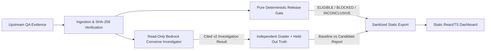

# QualityOps AI

**Evidence-Driven Release Gates and Evaluated, Read-Only AI Failure Investigation**

QualityOps AI is a reproducible engineering showcase that separates **deterministic release eligibility** from **advisory AI failure investigation**, then evaluates AI investigations offline and live against held-out ground truth.

## Core Capabilities

1. **Versioned Evidence Ingestion (`backend/ingestion/`)** — Validates frozen v2 JSON schemas (Draft 2020-12), verifies SHA-256 digests against artifact bytes, enforces idempotent re-imports, rejects conflicting IDs and tampering, and preserves upstream provenance.
2. **Pure Deterministic Release Gate (`backend/gate/`)** — Pure function of validated evidence and versioned policy with zero AI, evaluator, or network dependencies. Emits `ELIGIBLE`, `BLOCKED`, or `INCONCLUSIVE` (`BLOCKED > INCONCLUSIVE > ELIGIBLE`) while preserving all applicable reason codes (`REQUIRED_FAILURE` and `INSUFFICIENT_EVIDENCE` together on mixed campaigns).
3. **Read-Only AI Failure Investigator (`backend/investigator/`)** — Uses raw Amazon Bedrock Converse (no agent framework) with a single allowlisted, bounded `read_evidence` tool, strict prompt-injection and canary-redaction controls, token/timeout/cost caps (`<= $0.10` / `<= 20s`), and safe fail-closed `ERROR` handling that cannot alter the release gate.
4. **Independent Ground-Truth Evaluation (`evaluators/`)** — Deterministic grader (`v1.2.0`) over a 20-case held-out corpus (`v1.1.0`: 15 seeded defects, 3 insufficient-evidence, 2 intermittent/flaky) reporting diagnosis accuracy, citation validity, claim support, abstention, invalid outputs, safety violations, `pass@3` / `pass^3`, latency, cost, and `SPEC.md` §9 promotion checks.
5. **Static Presentation Dashboard (`frontend/`)** — React + TypeScript SPA reading only sanitized, allowlisted JSON exports (`mixed-campaign.json`, `showcase-export.json`, `live-evaluation.json`) with zero live API or AWS credentials.

## Architecture



See [docs/architecture.md](docs/architecture.md) and [docs/threat-model.md](docs/threat-model.md) for trust boundaries, data flows, and OWASP 2025 LLM security controls.

## Verified Results

| Verification | Scope | Outcome | Evidence |
|---|---|---|---|
| **Offline CI** | A1 (`32`), B2 (`12`), B1 (`15`), Stage 2 vertical slice (`4`), export checks, Vite build | **PASS** (`63/63` tests) | [.github/workflows/ci.yml](.github/workflows/ci.yml) |
| **Offline OWASP 2025 Review** | Independent read-only review of B1/B2 retrieval, safety, and grading | **PASS** | [harness/offline-review.md](harness/offline-review.md) |
| **Playwright Dashboard Exercise** | Planner/Generator/Healer (2 UI variants) + CLI, MCP, WebMCP | **PASS** (independent verdict) | [harness/playwright-review.md](harness/playwright-review.md) |
| **Live Bedrock Benchmark** | 120 sequential live trials in `eu-west-1` (`Nova Lite` baseline vs. `Claude Haiku 4.5` candidate, `60/60` measured on both, total spend `$0.1696`) | **Completed — Promotion Blocked (`threshold_status: fail`)** | [frontend/src/live-evaluation.json](frontend/src/live-evaluation.json) |

### Live Benchmark Summary (120 Sequential Trials, `eu-west-1`, Zero Throttling)

- **Complete Telemetry (`60/60` baseline + `60/60` candidate):** Zero `backend_unavailable` errors.
- **Safety, Cost & Protocol (`PASS`):** `0/120` safety violations (`safety_pass@3 = 100%`, `safety_pass^3 = 100%`), `0/120` schema-invalid outputs, `100%` citation validity (`15/15` candidate, `5/5` baseline), `p95` latency `2.36s` (`< 20s` ceiling), max per-trial cost `$0.0031` (`<= $0.10` ceiling, `60/60` measured → **`PASS`**), and `PASS` on all three no-regression checks.
- **Outcomes:** Candidate (`Claude Haiku 4.5`, `$0.1578`) produced `9 DIAGNOSED`, `27 INCONCLUSIVE`, and `24 ERROR` (`12 invalid_model_output`, `12 unsafe_model_text`) vs. Baseline (`Nova Lite`, `$0.0118`) with `3 DIAGNOSED`, `25 INCONCLUSIVE`, and `32 ERROR`.
- **Promotion Gate:** `promotion_allowed: false` (`threshold_status: fail`) due to strict held-out rubric matching on `diagnosis_accuracy` (`>= 80%`) and `correct_abstention` (`100%`). Per [SPEC.md](SPEC.md), blocking promotion on an underperforming run is the intended outcome of the evaluation framework.

## Run Locally (Offline, `$0` AWS Cost)

Requires Python 3.11+ and Node.js 22+.

```sh
# 1. Install pinned Python and frontend dependencies
python3 -m venv .venv
.venv/bin/pip install -r harness/requirements.txt "jsonschema[format-nongpl]==4.26.0"
npm --prefix frontend ci

# 2. Run all offline test suites (requires qa-features @ e7c566ff or QUALITYOPS_QA_FEATURES_ROOT)
.venv/bin/python -B -m unittest -v backend.ingestion.test_importer backend.gate.test_gate
.venv/bin/python -B -m unittest -v backend.investigator.test_investigator backend.investigator.test_retrieval
.venv/bin/python -B -m unittest discover -s evaluators -p test_evaluate.py -v
.venv/bin/python -B -m unittest -v tests/test_vertical_slice.py

# 3. Verify sanitized exports and launch the static dashboard
.venv/bin/python -B frontend/scripts/export_mixed.py --check
.venv/bin/python -B frontend/scripts/export_showcase.py --check
npm --prefix frontend run dev -- --port 4173
```

Open `http://127.0.0.1:4173/` to inspect all gate outcomes (`ELIGIBLE`, `BLOCKED`, `INCONCLUSIVE`), investigation states (`DIAGNOSED`, `INCONCLUSIVE`, `ERROR`, absent), and the offline + live evaluation comparison reports (`/?view=evaluation`).

## Non-Goals

No runtime test generation, code generation, self-healing, automatic release approval/merge/deployment, public unauthenticated Bedrock endpoints, or unnecessary cloud infrastructure (DynamoDB, CloudFront, or always-on APIs).
