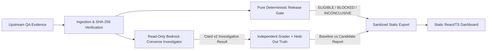
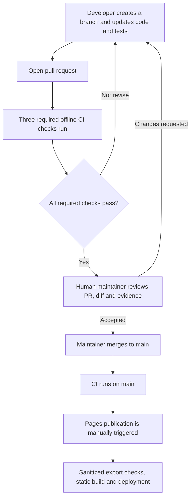

# QualityOps AI

QualityOps AI ingests QA campaign evidence, computes release eligibility from versioned policy, investigates failures with a read-only AI, and grades those investigations against held-out evidence mappings. The static React and TypeScript dashboard presents recorded results from those four capabilities. [Open the live dashboard](https://camiloavilacm.github.io/QualityOps-AI/)

## Two engineering decisions

**Keep both reasons for blocking a release.** In the mixed campaign, execution `x` had a confirmed mandatory failure and execution `y` had no observation. A disposable dashboard change hid the missing-evidence reason while still showing `BLOCKED`. Playwright caught it on the first attempt. The reviewer accepted a locator repair for a renamed link and retained the assertion that exposed the lost reason. After the frontend setup and build below, run `npm --prefix frontend run test:e2e -- mixed-campaign.spec.ts` to check both reasons on the local dashboard. [Exercise, traces and independent verdict](https://github.com/camiloavilacm/QualityOps-AI/blob/ea54a02d24a7a0f424837cfbf55cd6b81cb8bf26/harness/playwright-review.md#current-main-replay-2026-11-26)

**Block promotion of the model candidate.** Across 60 Claude Haiku 4.5 trials, all 15 emitted citations resolved. Grader 1.2.0 credited 0/45 diagnoses and 0/15 required abstentions. All nine causal claims remained pending support review. The failed diagnosis and abstention thresholds blocked promotion. To check how the recorded decision appears offline, run `npm --prefix frontend run test:e2e -- --grep 'evaluation view displays'`. [Recorded Bedrock benchmark](https://github.com/camiloavilacm/QualityOps-AI/blob/ea54a02d24a7a0f424837cfbf55cd6b81cb8bf26/frontend/src/live-evaluation.json)

## Skills and evidence

### Foundations

| Skill | What we tested | Where to inspect it | Coverage limit |
|---|---|---|---|
| Python automation and runner interoperability | The importer read two recorded campaigns and verified 18 observed executions against 18 expected per campaign. | [Importer test](backend/ingestion/test_importer.py#L66) and [pinned baseline receipt](backend/ingestion/receipts/baseline.json) | Playwright, Cypress and Selenium executions came from upstream `qa-features`. QualityOps owns the adapter and its Python tests. |
| TypeScript and Playwright | A browser test followed a diagnosed finding to the cited evidence and checked the resulting URL fragment. | [Dashboard flows](frontend/tests/dashboard-flows.spec.ts) | Desktop Chromium. Dedicated accessibility and cross-device suites remain gaps. |
| CI/CD, Docker and Linux | The accepted Linux/amd64 container run verified the browser, mutation and WebMCP checks. The recorded CI run passed all three required jobs. | [Stage 4 implementation record](harness/container/implementation-record.json) | Pages publication requires a separate manual workflow run. |
| Cloud operations | The recorded Bedrock comparison ran 60 trials per configuration in `eu-west-1`. | [Benchmark measurements](frontend/src/live-evaluation.json) | The [infrastructure template](infrastructure/template.yaml) describes the proposed AWS resources. The benchmark documents model calls. |

### Craft

| Skill | What we tested | Where to inspect it | Coverage limit |
|---|---|---|---|
| Contracts and backend validation | The importer checks the v2 evidence schema and artifact SHA-256 values before atomic filesystem publication. Its retry test rejects a conflicting payload under the same campaign ID. | [Duplicate and conflict test](backend/ingestion/test_importer.py#L343) | The interface is a campaign bundle and trusted receipt. REST and Postman coverage remain open. |
| Risk-based test design | **Automate** the independent checks for failure and missing evidence. **Review manually** whether a locator repair still selects the intended campaign. **Defer** mobile-viewport checks. | [Mixed-campaign test](frontend/tests/mixed-campaign.spec.ts) | The first attempt caught the dropped reason even though the decision still read `BLOCKED`. |
| Reliability and observability | Simulated outage and timeout yield explicit error reasons. A budget check stops the first call when its reserved cost exceeds the cap. | [Outage, timeout and budget tests](backend/investigator/test_investigator.py#L154) | The recorded candidate had 2,356 ms p95 latency, USD 0.157806 total estimated cost and 24/60 errors. Application load and production drift remain unmeasured. [Telemetry](frontend/src/live-evaluation.json) |

### AI

| Skill | What we tested | Where to inspect it | Coverage limit |
|---|---|---|---|
| LLM security and tool authorization | The bounded `read_evidence` tool accepts approved evidence IDs. Retrieval tests exercise prompt injection, cross-campaign requests and redaction. Unauthorized reads returned no protected content in the reviewed cases. | [Retrieval tests](backend/investigator/test_retrieval.py) and [OWASP 2025 LLM review](harness/offline-review.md) | The review covers the pinned fixture and tool configuration. |
| Investigator evaluation | Offline Converse replay checked the ordered evidence reads and passed the final investigation record to the grader. The two citations resolved and claim support required review. | [Investigator-to-grader test](evaluators/test_evaluate.py#L124) | This is a recorded-response check. Live model performance comes from separately authorized trials. |
| AI-assisted test authoring | CLI, Playwright MCP and WebMCP returned the same mixed-campaign decision and reason pairs. An unknown campaign lookup was rejected. | [Matched interface exercise](harness/playwright-review.md#matched-climcpwebmcp-comparison-2026-11-26) | The exercise followed Planner/Generator/Healer roles manually. Dedicated Test Agent MCP actions were unavailable. CLI and MCP token use was unmeasured. |

## Start Here

To look around the dashboard, you need Node.js 22.12 or newer and npm. From the repository root:

```sh
npm --prefix frontend ci
npm --prefix frontend run dev -- --port 4173
```

Open <http://127.0.0.1:4173/>. Select the sample campaigns to see `ELIGIBLE`, `BLOCKED`, and `INCONCLUSIVE` decisions, recorded investigation examples, evidence links, and the evaluation view at `/?view=evaluation`. These are synthetic or previously recorded examples; the dashboard does not connect to your test systems, execute your tests, or invoke a model. Press Ctrl+C in the terminal to stop the local server.

## Architecture



See [docs/architecture.md](docs/architecture.md) and [docs/threat-model.md](docs/threat-model.md) for trust boundaries, data flows, and OWASP 2025 LLM security controls.

## Review and publication



The recorded `main` ruleset requires a pull request and three checks, `python-contracts-and-eval`, `frontend-e2e` and `frontend-webmcp`. CODEOWNERS routes review to the repository owner. The project requires maintainer review, but **the ruleset requires zero approving reviews**. A PR with green checks can therefore meet branch protection without a submitted approval. [Code owners](.github/CODEOWNERS) and [recorded ruleset](harness/artifacts/h1-remote-enforcement-20261125/summary.json)

To publish, a maintainer manually runs **Deploy Static Dashboard to GitHub Pages** from GitHub Actions. The workflow checks sanitized exports, builds the static dashboard, uploads the artifact and deploys it. Merging to `main` alone does not publish a new dashboard. [Pages workflow](.github/workflows/pages.yml) and [deployment record](harness/container/implementation-record.json)

Live Bedrock evaluation uses a separate manual workflow restricted to `main` and its protected environment. Each paid run requires explicit authorization.

## Run the Offline Checks

Previewing the dashboard above needs only Node.js 22.12+ and npm. The Python checks use Python 3.12 in CI and pinned dependencies. They do not call AWS or Bedrock. The ingestion tests also need the read-only `qa-features` reference at commit `e7c566ff831139889195643a1b906b7edab76f48`; the commands below prepare a separate checkout and copy only this repository's fixture into it.

From the repository root, install the Python dependencies:

```sh
python3 -m venv .venv
.venv/bin/pip install -r harness/requirements.txt "jsonschema[format-nongpl]==4.26.0"
```

Prepare the pinned test reference in a fresh sibling directory. Do not use your working checkout of `qa-features` for this:

```sh
git clone https://github.com/camiloavilacm/qa-features.git ../qualityops-qa-features
git -C ../qualityops-qa-features checkout --detach e7c566ff831139889195643a1b906b7edab76f48
mkdir -p ../qualityops-qa-features/harness/evidence/readme-runs/failure
cp -R samples/recorded/archive-failure/. ../qualityops-qa-features/harness/evidence/readme-runs/failure/
export QUALITYOPS_QA_FEATURES_ROOT="$(cd ../qualityops-qa-features && pwd)"
```

Run the contract, Python, and sanitized-export checks:

```sh
.venv/bin/python -B harness/checks.py contracts
.venv/bin/python -B -m unittest -v backend.ingestion.test_importer backend.gate.test_gate
.venv/bin/python -B -m unittest -v backend.investigator.test_investigator backend.investigator.test_retrieval
.venv/bin/python -B -m unittest discover -s evaluators -p test_evaluate.py -v
.venv/bin/python -B -m unittest -v tests/test_vertical_slice.py
.venv/bin/python -B frontend/scripts/export_mixed.py --check
.venv/bin/python -B frontend/scripts/export_showcase.py --check
npm --prefix frontend ci
npm --prefix frontend run build
```

To run the regular Playwright browser suite locally, install its Chromium browser once and run the E2E command:

```sh
npm --prefix frontend run pw -- install chromium
npm --prefix frontend run test:e2e
```

The isolated WebMCP/guard/canary gates use the trusted runner in GitHub Actions. For its exact staged commands and limitations, see [the harness plan](docs/pr-verification-webmcp-harness-plan.md) and [.github/workflows/ci.yml](.github/workflows/ci.yml). A local run of only one component is not equivalent to an accepted cumulative container run.

## Non-Goals

No runtime test generation, code generation, self-healing, automatic release approval/merge/deployment, public unauthenticated Bedrock endpoints, or unnecessary cloud infrastructure (DynamoDB, CloudFront, or always-on APIs).
