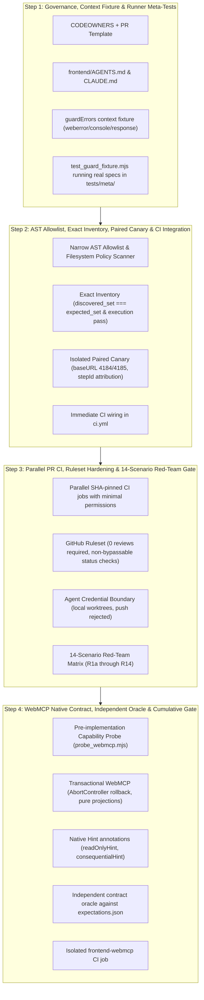

# Staged Release Plan (v6) — Trustworthy PR Verification, Agent Harness, Guardrails & WebMCP

**Central objective:** Demonstrate not just that an AI agent can generate or repair a Playwright test, but that deterministic verification, non-bypassable CI boundaries, and human review prove whether a proposed change preserves the original requirement, catches regressions, and is eligible for release.

---

## 1. Technical Audit Reconciliation (Findings F01–F12)

Every finding from the specification-level audit of v5 has been resolved in v6:

| Audit Finding | Severity | Resolution in v6 Specification |
|---|---|---|
| **F01: Solo-maintainer PR approval deadlock** | **Critical** | • Configure GitHub Ruleset on `main`: `Require pull request: YES`, **`Required approving reviews: 0`**, `Require status checks to pass before merging: YES` (`python-contracts-and-eval`, `frontend-e2e`, `frontend-webmcp`), `Do not allow bypassing: YES`, `Require branches to be up to date: YES`.<br>• Human review is operationally enforced by the **credential boundary** (agents hold zero push/merge credentials; maintainer documents review and merges), not by GitHub's PR approval count. |
| **F02: Guard meta-test layer mismatch** | **Critical** | • `test_guard_fixture.mjs` is an **orchestrator** invoking `playwright test` on `frontend/tests/meta/guard-verification.spec.ts`.<br>• Directly imports and exercises the **production fixture** `frontend/tests/fixtures/dashboard.ts` with `{ auto: true }` enabled under the real Playwright Test runner, testing clean pages and injected failures with strict reason attribution. |
| **F03: AST rules contradict fixture & helpers** | **Critical** | • Define **narrow, categorized AST policies**:<br>  1. *Ordinary specs (`frontend/tests/**/*.spec.ts`)*: Strict allowlist for `test()` and `expect()`; mandatory `./fixtures/dashboard` import; all browser escapes banned.<br>  2. *Production fixture (`tests/fixtures/dashboard.ts`)*: Allowed base extension and event listeners (`context.on('console')`, `weberror`, `response`, `requestfailed`).<br>  3. *Helpers (`tests/helpers/**/*.ts`)*: Recursively scanned; browser escapes banned.<br>  4. *Meta-tests (`tests/meta/**/*.ts`)*: Permitted intentional error trigger injection.<br>  5. *WebMCP spec (`tests/webmcp.spec.ts`)*: Permitted `page.evaluate()` exclusively for `document.modelContext`. |
| **F04: `.test.ts` escapes discovery** | **High** | • Add an **independent filesystem policy scanner** in `check_test_hygiene.mjs` that scans `frontend/tests/` for any test-like files (`*.test.ts`, `*.test.js`, `*.spec.js`, `*.spec.mts`, `*.tsx`) outside approved `*.spec.ts` files.<br>• Rejects any `test(...)` declaration outside approved spec files.<br>• Separates Red-Team scenarios: **R1a** (unapproved `.spec.ts` → inventory failure) vs **R1b** (unapproved `.test.ts` → filesystem policy failure). |
| **F05: WebMCP inventory unverified** | **High** | • `check_test_hygiene.mjs` is **project-aware** (`--project=<name>`).<br>• `frontend-e2e` runs `check:hygiene --project=chromium` (verifies 8 tests).<br>• `frontend-webmcp` runs `check:hygiene --project=chromium-webmcp` (verifies 3 tests).<br>• Both CI jobs independently verify AST hygiene, exact discovery, and execution report for their project. |
| **F06: Canary server selection & mutation isolation** | **High** | • `playwright.config.ts` uses `baseURL: process.env.PW_BASE_URL ?? 'http://127.0.0.1:4173'`. Skips internal webServer launch when `PW_BASE_URL` is set.<br>• Orchestrator checks port availability (4184, 4185) before launch; fails if occupied.<br>• Verifies mutation by querying the HTTP endpoint directly before browser execution.<br>• Positive run: `PW_BASE_URL=http://127.0.0.1:4184 PW_OUTPUT_DIR=artifacts/canary-positive`.<br>• Mutated run: `PW_BASE_URL=http://127.0.0.1:4185 PW_OUTPUT_DIR=artifacts/canary-mutated`.<br>• Attribution matches **test ID + step identifier** (`DASH-003-REASON-01`), returning `KILLED`. Missing report or timeout returns `INCONCLUSIVE`/`FAIL`. |
| **F07: `minExpects` assertion integrity limits** | **High** | • `minExpects` is explicitly defined as an **advisory regression ratchet** (detecting deleted assertions), NOT semantic proof of assertion correctness.<br>• AST counts `expect(...)` and `expect.poll(...)` calls.<br>• Semantic assertion validity is guaranteed by the **paired mutation canary + mandatory human review**. |
| **F08: Workflow & checker self-modification** | **High** | • **Scope review rule:** Healer PR changed-file scope is strictly limited to approved `*.spec.ts` files.<br>• Modifying `.github/workflows/`, `check_test_hygiene.mjs`, or `expected-tests.json` triggers immediate CI scope-check failure, requiring maintainer review.<br>• AST checker bans dangerous operations in ordinary specs: `page.evaluate`, `context.removeAllListeners`, `browser.newContext`, `routeFromHAR`, dynamic imports. |
| **F09: WebMCP native annotations & capability probe** | **High** | • Native Chromium WebMCP API uses `Hint` suffixes: `readOnlyHint: true`, `consequentialHint: false`, `untrustedContentHint: false`. Spec asserts `tool.annotations?.readOnlyHint === true`, `consequentialHint === false`, `untrustedContentHint === false`.<br>• Added mandatory pre-implementation runtime probe (`frontend/scripts/probe_webmcp.mjs`) to verify `document.modelContext`, `registerTool`, `getTools`, `executeTool`, annotations, and cleanup before implementing `webmcp.ts`. |
| **F10: WebMCP transactional lifecycle & read-only purity** | **High** | • `webmcp.ts` implements `AbortController` unwinding to abort prior registrations if a subsequent tool registration fails.<br>• Lifecycle meta-test verifies partial failure rolls back cleanly without leaving orphaned tools.<br>• Read-only purity: tools are pure projections over fixture data. Tests verify repeated execution leaves DOM, URL, localStorage, and sessionStorage completely unchanged. |
| **F11: Exact inventory execution contract** | **Medium** | • Test identity schema in `expected-tests.json` includes `id`, `project`, `file`, `titlePath`, `stepId`, `minExpects`. Rejects duplicate IDs.<br>• Execution check requires `discovered_set === expected_set`, and for every executed test: `expectedStatus === 'passed'`, `status === 'passed'`, `outcome === 'expected'`, and `executionCount === 1`. |
| **F12: Cumulative release gates & clean reproducibility** | **Medium** | • Gates 1 through 4 are **strictly cumulative**.<br>• Clean-checkout reproducibility: `npm ci`, pinned versions, explicit type checking (`tsc --noEmit`), and deterministic dependency resolution. |

---

## 2. Release Architecture Overview



---

## 3. Detailed Implementation Plan by Step

### Release Step 1 — Trustworthy Test Foundation

**Goal:** Establish ownership boundaries, agent capability contracts, context-level error observation across all specs, and prove negatively that the production error fixture catches injected failures with strict reason attribution under the real Playwright Test runner.

#### 1. Governance & Agent Instructions
- **[NEW] [.github/CODEOWNERS](file:///Users/camiloavila/Documents/qualityops-ai/.github/CODEOWNERS)** — Review routing for all critical subsystems:
  ```text
  /.github/ @camiloavilacm
  /.agents/ @camiloavilacm
  /AGENTS.md @camiloavilacm
  /contracts/ @camiloavilacm
  /backend/gate/ @camiloavilacm
  /backend/ingestion/ @camiloavilacm
  /evaluators/ground_truth/ @camiloavilacm
  /harness/ @camiloavilacm
  /samples/ @camiloavilacm
  /frontend/.codex/ @camiloavilacm
  /frontend/AGENTS.md @camiloavilacm
  /frontend/CLAUDE.md @camiloavilacm
  /frontend/package.json @camiloavilacm
  /frontend/package-lock.json @camiloavilacm
  /frontend/playwright.config.ts @camiloavilacm
  /frontend/scripts/ @camiloavilacm
  /frontend/src/mixed-campaign.json @camiloavilacm
  /frontend/src/showcase-export.json @camiloavilacm
  /frontend/src/live-evaluation.json @camiloavilacm
  /frontend/tests/ @camiloavilacm
  ```
- **[NEW] [.github/PULL_REQUEST_TEMPLATE.md](file:///Users/camiloavila/Documents/qualityops-ai/.github/PULL_REQUEST_TEMPLATE.md)** — Pull request checklist with mandatory sections for Agent role, changed test IDs, reason for changes, and maintainer verification.
- **[NEW] [frontend/AGENTS.md](file:///Users/camiloavila/Documents/qualityops-ai/frontend/AGENTS.md)** — Agent steering rules referencing existing `frontend/.codex/agents/playwright_test_{planner,generator,healer}.toml`, capability matrix, mandatory `./fixtures/dashboard` import, Healer JSON schema, and CI validation boundaries. Clarifies that CI mechanically verifies execution, inventory, AST allowlist, and regression kills, while semantic diff review remains the responsibility of the human maintainer.
- **[NEW] [frontend/CLAUDE.md](file:///Users/camiloavila/Documents/qualityops-ai/frontend/CLAUDE.md)** — Single-line `@AGENTS.md` import.

#### 2. Test Infrastructure & Error Guard
- **[MODIFY] [frontend/index.html](file:///Users/camiloavila/Documents/qualityops-ai/frontend/index.html)** — Add inline SVG data-URI favicon to eliminate browser `/favicon.ico` 404s.
- **[NEW] [frontend/tests/fixtures/dashboard.ts](file:///Users/camiloavila/Documents/qualityops-ai/frontend/tests/fixtures/dashboard.ts)** —
  - `guardErrors` (`{ auto: true }`): Attaches **context-level** listeners (`weberror`, `console`, `response`, `requestfailed`), accumulates diagnostics (never throwing inside async handlers), attaches them via `testInfo.attach`, and fails during teardown if any uncaught JS error, `console.error`, same-origin `status >= 400`, or unexpected network failure occurred during the test window.
  - Documented cancellation policy: ignores only `net::ERR_ABORTED` requests that are legitimate client navigation cancellations.
  - `dashboard`: Navigation helpers (`openHome`, `openCampaign`, `openEvaluation`); assertions remain explicit in specs.
- **[MODIFY] [seed.spec.ts](file:///Users/camiloavila/Documents/qualityops-ai/frontend/tests/seed.spec.ts), [mixed-campaign.spec.ts](file:///Users/camiloavila/Documents/qualityops-ai/frontend/tests/mixed-campaign.spec.ts), [dashboard-flows.spec.ts](file:///Users/camiloavila/Documents/qualityops-ai/frontend/tests/dashboard-flows.spec.ts)** — Migrate all 3 specs to import `{ test, expect }` exclusively from `./fixtures/dashboard`.

#### 3. Runner-Managed Guard Meta-Tests (F02 Fix)
- **[NEW] [frontend/tests/meta/guard-verification.spec.ts](file:///Users/camiloavila/Documents/qualityops-ai/frontend/tests/meta/guard-verification.spec.ts)** — Real Playwright Test spec importing the **actual production fixture** `frontend/tests/fixtures/dashboard.ts`. Contains individual test cases targeting controlled local mock pages:
  1. `clean-page`: Confirms clean page passes with no guard errors.
  2. `uncaught-js-error`: Triggers uncaught exception via script; expects failure with reason `UNCAUGHT_JS_ERROR`.
  3. `console-error`: Calls `console.error()`; expects failure with reason `CONSOLE_ERROR`.
  4. `same-origin-404`: Fetches local missing endpoint; expects failure with reason `HTTP_404`.
  5. `same-origin-500`: Fetches local 500 endpoint; expects failure with reason `HTTP_500`.
  6. `request-failed`: Calls unreachable port; expects failure with reason `REQUEST_FAILED`.
  7. `second-tab-error`: Opens second page in context and emits error; expects failure with reason `UNCAUGHT_JS_ERROR`.
  8. `navigation-abort`: Performs legitimate page navigation abort; confirms clean pass.
- **[NEW] [frontend/scripts/test_guard_fixture.mjs](file:///Users/camiloavila/Documents/qualityops-ai/frontend/scripts/test_guard_fixture.mjs)** — Orchestrator script that starts a local mock HTTP server, runs `npx playwright test tests/meta/guard-verification.spec.ts --reporter=json`, and asserts that:
  - The clean test passed with outcome `expected`.
  - All 6 negative tests failed with outcome `unexpected`.
  - In each failure, the JSON report error message originated from `guardErrors` and explicitly matched the expected failure reason code.

#### Gate 1 Verification (Cumulative)
```sh
npm --prefix frontend ci
npm --prefix frontend run build
npm --prefix frontend run test:e2e
node frontend/scripts/test_guard_fixture.mjs
```

---

### Release Step 2 — Trustworthy Verification (AST Policy, Exact Inventory, Paired Canary & CI Integration)

**Goal:** Enforce narrow AST allowlisting, independent filesystem test discovery policy, exact test inventory and minExpects, run a strict `KILLED`-only paired mutation canary with server isolation, and wire all checks into CI immediately.

#### 1. Configuration & Inventory Schema
- **[MODIFY] [frontend/playwright.config.ts](file:///Users/camiloavila/Documents/qualityops-ai/frontend/playwright.config.ts)** —
  - `baseURL: process.env.PW_BASE_URL ?? 'http://127.0.0.1:4173'`
  - `webServer`: configure conditional launch (`reuseExistingServer: !process.env.CI`, skipped if `process.env.PW_BASE_URL` is set).
  - Pin `testMatch: '**/*.spec.ts'`, `testIgnore: ['**/fixtures/**', '**/helpers/**', '**/meta/**']`.
  - Set `forbidOnly: true`, `retries: 0`, `trace: 'retain-on-failure'`, `outputDir: process.env.PW_OUTPUT_DIR || 'test-results'`.
- **[NEW] [frontend/tests/expected-tests.json](file:///Users/camiloavila/Documents/qualityops-ai/frontend/tests/expected-tests.json)** —
  - Per-project schema with stable IDs and step attribution:
    ```json
    {
      "projects": {
        "chromium": {
          "expectedCount": 8,
          "tests": [
            {
              "id": "DASH-001",
              "file": "tests/seed.spec.ts",
              "titlePath": ["Seed verification", "renders dashboard title and tabs"],
              "minExpects": 2
            },
            {
              "id": "DASH-003",
              "file": "tests/mixed-campaign.spec.ts",
              "titlePath": ["Mixed campaign reconciliation", "displays all required reasons"],
              "stepId": "DASH-003-REASON-01",
              "minExpects": 6
            }
          ]
        }
      }
    }
    ```
  - Rejects any duplicate test `id` or `titlePath` upon load.

#### 2. AST Allowlist & Filesystem Policy Checker (F03, F04, F05, F07, F08 Fixes)
- **[NEW] [frontend/scripts/check_test_hygiene.mjs](file:///Users/camiloavila/Documents/qualityops-ai/frontend/scripts/check_test_hygiene.mjs)** —
  - Accepts CLI argument: `--project=<chromium|chromium-webmcp>` (defaults to `chromium`).
  - **Single config rule:** Verifies only `frontend/playwright.config.ts` exists.
  - **Independent Filesystem Policy Scanner (F04):**
    - Scans `frontend/tests/**`.
    - Rejects any files matching test patterns outside approved `*.spec.ts` (e.g. `*.test.ts`, `*.test.js`, `*.spec.js`, `*.spec.mts`, `*.tsx`).
    - Rejects any AST `test(...)` declaration found in any file other than approved spec files.
  - **Narrow Categorized AST Rules (F03, F08):**
    - *Approved specs (`*.spec.ts` outside `meta/`)*:
      - `test` only allowed as `test()`, `test.describe()`, `test.step()`, and standard lifecycle hooks.
      - Any property access (`test.skip`, `test.only`, `test.fail`, `test.fixme`, `test.slow`, `test.use`, `test.extend`) or aliasing (`const t = test`, `{ skip } = test`) is strictly rejected.
      - `expect` only allowed as `expect()` or `expect.poll()`. Banned: `expect.soft`, `expect.configure`, aliasing.
      - Browser escapes strictly banned: `page.evaluate`, `addInitScript`, `exposeFunction`, `exposeBinding`, `context.route`, `page.route`, `on('console')`, `context.removeAllListeners`, `browser.newContext`, `routeFromHAR`, dynamic imports, `waitForTimeout`, empty `catch {}`.
      - Mandatory import: `import { test, expect } from './fixtures/dashboard'`.
    - *Fixtures (`tests/fixtures/dashboard.ts`)*: Allowed base Playwright extension and event listeners (`context.on('console')`, `weberror`, `response`, `requestfailed`).
    - *Helpers (`tests/helpers/**/*.ts`)*: Scanned recursively for banned browser escapes.
    - *Meta-tests (`tests/meta/**/*.ts`)*: Excluded from ordinary inventory; verified separately.
    - *WebMCP spec (`tests/webmcp.spec.ts`)*: Permitted `page.evaluate()` exclusively for calling native `document.modelContext`.
  - **Assertion Count Ratchet (F07):**
    - Counts `expect(...)` and `expect.poll(...)` calls per test block; fails if `actual < minExpects`.
    - Documents in report that `minExpects` is an assertion-quantity ratchet, while semantic validity is verified by canary + review.
  - **Workflow and Config Checks:**
    - Verifies `playwright.config.ts` has `retries: 0`, `forbidOnly: true`.
    - Verifies `ci.yml` has no `continue-on-error`, `|| true`, or bypass flags.
  - **Exact-Set Project Discovery & Execution Inventory (F05, F11):**
    - Runs `npx playwright test --list --reporter=json --project=<project>`.
    - Validates `discovered_set === expected_set` (exact set equality: no missing tests, zero unexpected extra tests).
    - When `--report <json>` is provided:
      - Validates that every test in `expected_set` executed.
      - Validates `expectedStatus === 'passed'`, `status === 'passed'`, `outcome === 'expected'`, and `executionCount === 1`.
- **[NEW] [frontend/scripts/check_test_hygiene.test.mjs](file:///Users/camiloavila/Documents/qualityops-ai/frontend/scripts/check_test_hygiene.test.mjs)** — `node --test` suite validating that allowed patterns pass, and all banned snippets, aliases, escapes, and unapproved filenames fail.

#### 3. Isolated Paired Canary (F06 Fix)
- **[NEW] [frontend/scripts/check_canary_regression.mjs](file:///Users/camiloavila/Documents/qualityops-ai/frontend/scripts/check_canary_regression.mjs)** —
  1. Checks that ports 4184 and 4185 are free; fails immediately if occupied.
  2. Runs `npm run build` to ensure clean built preview assets.
  3. Launches positive preview server on port 4184.
  4. Launches mutated server on port 4185 (with `INSUFFICIENT_EVIDENCE` removed from the fixture payload in memory/endpoint).
  5. Directly verifies via HTTP `fetch('http://127.0.0.1:4185/...')` that the mutation is active in the served payload before running Playwright.
  6. Executes positive control:
     ```sh
     PW_BASE_URL=http://127.0.0.1:4184 PW_OUTPUT_DIR=artifacts/canary-positive \
     npx --no-install playwright test tests/mixed-campaign.spec.ts --project=chromium --reporter=json
     ```
     Asserts positive run passes with outcome `expected`.
  7. Executes mutated run:
     ```sh
     PW_BASE_URL=http://127.0.0.1:4185 PW_OUTPUT_DIR=artifacts/canary-mutated \
     npx --no-install playwright test tests/mixed-campaign.spec.ts --project=chromium --reporter=json
     ```
  8. Evaluates result:
     - Classifies result as **`KILLED`** only if:
       * Positive run passed completely.
       * Mutated run failed on test `DASH-003`.
       * Failure occurred inside step `DASH-003-REASON-01` on the `INSUFFICIENT_EVIDENCE` assertion.
     - Any timeout, crash, port collision, or unlocated error returns **`FAIL / INCONCLUSIVE`**.
  9. Guaranteed `finally` cleanup to terminate both preview servers.

#### 4. Package & CI Wiring
- **[MODIFY] [frontend/package.json](file:///Users/camiloavila/Documents/qualityops-ai/frontend/package.json)** —
  - `"test:e2e": "playwright test --project=chromium"`
  - `"check:hygiene": "node scripts/check_test_hygiene.mjs"`
  - `"test:hygiene": "node --test scripts/check_test_hygiene.test.mjs"`
  - `"test:guard": "node scripts/test_guard_fixture.mjs"`
  - `"test:canary": "node scripts/check_canary_regression.mjs"`
- **[MODIFY] [.github/workflows/ci.yml](file:///Users/camiloavila/Documents/qualityops-ai/.github/workflows/ci.yml)** — Wire `test:hygiene`, `check:hygiene`, `test:guard`, `test:e2e` (with report verification), and `test:canary` into CI immediately.

#### Gate 2 Verification (Cumulative)
```sh
npm --prefix frontend ci
npm --prefix frontend run test:hygiene
npm --prefix frontend run check:hygiene -- --project=chromium
node frontend/scripts/test_guard_fixture.mjs
npm --prefix frontend run build
npm --prefix frontend run test:e2e
npm --prefix frontend run test:canary
```

---

### Release Step 3 — Parallel PR CI, Ruleset Hardening & Mandatory Red-Team Gate

**Goal:** Parallelize CI, enforce non-bypassable GitHub branch protection with agent credential isolation, and execute an expanded 14-scenario red-team matrix proving that guardrails prevent regressions and unauthorized changes.

#### 1. CI Workflow Hardening & Job Separation
- **[MODIFY] [.github/workflows/ci.yml](file:///Users/camiloavila/Documents/qualityops-ai/.github/workflows/ci.yml)** —
  - `on: { pull_request: { branches: [main] }, push: { branches: [main] } }` (no path filtering).
  - Concurrency: `group: ${{ github.workflow }}-${{ github.ref }}`, `cancel-in-progress: ${{ github.event_name == 'pull_request' }}`.
  - Minimal permissions: `permissions: { contents: read }`, `persist-credentials: false`.
  - All GitHub Actions pinned to full 40-character commit SHAs.
  - Parallel jobs:
    1. `python-contracts-and-eval`: Pinned Python, `pytest` (63 tests), `python -m backend.export.generate --check`, summary upload.
    2. `frontend-e2e`: Pinned Node, `npm ci`, `test:hygiene`, `check:hygiene --project=chromium`, `build`, `test:guard`, `test:e2e` (`artifacts/e2e/report.json`), inventory execution check, `test:canary` (`artifacts/canary/`), always upload JSON evidence (7d), upload traces `if: failure()` (7d), summary upload.
- **[NEW] [.github/dependabot.yml](file:///Users/camiloavila/Documents/qualityops-ai/.github/dependabot.yml)** — Weekly dependency checking for `github-actions`.

#### 2. Ruleset Hardening & Agent Credential Boundary (F01 Fix)
- **GitHub Ruleset Configuration on `main`**:
  - Target: default branch (`main`).
  - Enforcement status: **Active** (non-bypassable).
  - Rules:
    - **Require a pull request before merging: YES**
    - **Required approving reviews: 0** *(Eliminates solo-maintainer self-approval deadlock; human review is operationally enforced by credential boundary)*
    - **Require status checks to pass before merging: YES**
      * Status checks: `python-contracts-and-eval`, `frontend-e2e` *(and `frontend-webmcp` in Step 4)*
    - **Require branches to be up to date before merging: YES**
    - **Do not allow bypassing the above settings: YES**
- **Agent Credential Boundary:**
  - AI agents operate in local Git worktrees or feature branches.
  - Agent environments are withheld personal access tokens and SSH keys with write permissions to `main`.
  - Maintainer performs final review, signs off, and triggers merge using human credentials.
- **Scope Review Policy (F08 Fix):**
  - Healer PR changed-file scope is strictly limited to approved spec files (`frontend/tests/*.spec.ts`).
  - PRs touching `.github/workflows/`, `check_test_hygiene.mjs`, `playwright.config.ts`, or `expected-tests.json` trigger immediate CI scope check failure unless explicitly marked with maintainer authorization.

#### 3. Expanded 14-Scenario Red-Team Matrix (Gate 3)
Run all 14 scenarios in isolated disposable branches to confirm the verification engine blocks every vector:

| ID | Injected Problem / Mutation | Expected Detection Mechanism | Expected Result |
|---|---|---|---|
| **R1a** | Add unapproved `tests/unapproved.spec.ts` | Exact-Set Inventory Check | CI FAILS (unexpected test in inventory) |
| **R1b** | Add unapproved `tests/unapproved.test.ts` | Filesystem Policy Scanner | CI FAILS (unapproved test filename) |
| **R2** | Add `continue-on-error: true` in `ci.yml` | Workflow Hygiene Checker | CI FAILS (banned workflow keyword) |
| **R3** | Call `waitForTimeout` or `addInitScript` in `tests/helpers/bad.ts` | Recursive AST Hygiene Scanner | CI FAILS (banned browser escape in helper) |
| **R4** | Delete assertion so `expect` count drops below `minExpects` | AST Assertion Count Ratchet | CI FAILS (assertion count below minimum) |
| **R5** | Remove `INSUFFICIENT_EVIDENCE` assertion from spec | Paired Mutation Canary | CI FAILS (canary not killed at location) |
| **R6** | Add `test.skip()`, `test.only()`, or `const t = test` | AST Allowlist Checker | CI FAILS (property access or aliasing) |
| **R7** | Valid locator repair preserving assertions | Full CI Pipeline | ALL CHECKS PASS (clean PR candidate) |
| **R8** | Change `retries: 2` in `playwright.config.ts` | Config Hygiene Validator | CI FAILS (retries must be 0) |
| **R9** | Remove `guardErrors` fixture import from spec | Spec Import-Source Rule | CI FAILS (missing mandatory fixture import) |
| **R10** | Remove mandatory CI step from `ci.yml` | Workflow Structure Validator | CI FAILS (required step missing) |
| **R11** | Replace `check_test_hygiene.mjs` with no-op script | Healer Scope Check & Diff Audit | CI FAILS (forbidden file change in PR) |
| **R12** | Attempt PR merge with failing required CI check | GitHub Branch Ruleset | MERGE BLOCKED by GitHub |
| **R13** | Replace approved test with unapproved test title | Exact-Set Inventory Check | CI FAILS (mismatched test identity) |
| **R14** | Attempt direct `git push origin main` without maintainer token | Git Remote / Ruleset | PUSH REJECTED (protected branch) |

#### Gate 3 Verification (Cumulative)
```sh
npm --prefix frontend ci
npm --prefix frontend run test:hygiene
npm --prefix frontend run check:hygiene -- --project=chromium
node frontend/scripts/test_guard_fixture.mjs
npm --prefix frontend run build
npm --prefix frontend run test:e2e
npm --prefix frontend run test:canary
python3 -m pytest tests/
python3 -m backend.export.generate --check
# Execute Red-Team verification script:
node frontend/scripts/verify_red_team_matrix.mjs
```

---

### Release Step 4 — Trustworthy WebMCP Interface & Isolated Verification

**Goal:** Ship a verified, transactional, read-only WebMCP interface using native Chromium WebMCP APIs with `Hint` annotations, standard MCP result envelopes, transactional rollback, and validation against an independent contract oracle in an isolated CI job.

#### 1. Pre-Implementation Capability Probe (F09 Fix)
- **[NEW] [frontend/scripts/probe_webmcp.mjs](file:///Users/camiloavila/Documents/qualityops-ai/frontend/scripts/probe_webmcp.mjs)** — Runtime capability probe executed against Chromium `159.0.8154.6` with `--enable-features=WebMCP`. Verifies:
  1. Browser version matches pinned requirement.
  2. `document.modelContext` exists on the browser window object.
  3. `registerTool` registers a minimal dummy tool.
  4. `getTools` discovers the registered tool.
  5. `executeTool` executes the tool and returns expected JSON.
  6. Annotation properties support `readOnlyHint`, `consequentialHint`, and `untrustedContentHint`.
  7. `AbortController` signal cleanly unregisters the dummy tool.
  8. Unsupported browser/flag environment fails gracefully without throwing uncaught errors.

#### 2. Native WebMCP Implementation & Transactional Lifecycle (F09, F10 Fixes)
- **[NEW] [frontend/src/webmcp.ts](file:///Users/camiloavila/Documents/qualityops-ai/frontend/src/webmcp.ts)** —
  - Pure functions: constructs responses exclusively from imported frozen static data (`mixed-campaign.json`, `showcase-export.json`).
  - Read-only purity: tool execution performs zero mutations on DOM, application state, URL, `localStorage`, or `sessionStorage`.
  - Transactional registration:
    ```ts
    const controller = new AbortController();
    try {
      await registerTool(tool1, { signal: controller.signal });
      await registerTool(tool2, { signal: controller.signal });
    } catch (err) {
      controller.abort(); // Rollback any registered tools on partial failure
      console.warn('WebMCP registration aborted:', err);
    }
    ```
  - Registers two tools with exact native annotations:
    - `get_campaign_summary`: `readOnlyHint: true`, `consequentialHint: false`, `untrustedContentHint: false`
    - `get_evaluation_summary`: `readOnlyHint: true`, `consequentialHint: false`, `untrustedContentHint: false`
  - Strict input validation against contract enums and regexes.
  - Standard MCP result envelope:
    ```json
    {
      "content": [
        {
          "type": "text",
          "text": "{\"decision\":\"INCONCLUSIVE\",...}"
        }
      ],
      "isError": false
    }
    ```
    On invalid/unknown arguments, returns `{ content: [{ type: "text", text: "..." }], isError: true }`.
- **[MODIFY] [frontend/src/main.tsx](file:///Users/camiloavila/Documents/qualityops-ai/frontend/src/main.tsx)** — Calls `registerDashboardWebMCP()`.
- **[MODIFY] [.github/CODEOWNERS](file:///Users/camiloavila/Documents/qualityops-ai/.github/CODEOWNERS)** — Add `/frontend/src/webmcp.ts @camiloavilacm`.

#### 3. Test Suites & Independent Oracle Verification (F09, F10 Fixes)
- **[MODIFY] [frontend/playwright.config.ts](file:///Users/camiloavila/Documents/qualityops-ai/frontend/playwright.config.ts)** —
  - `chromium`: `testIgnore: ['**/webmcp.spec.ts', '**/fixtures/**', '**/helpers/**', '**/meta/**']`
  - `chromium-webmcp`:
    - `testMatch: '**/webmcp.spec.ts'`
    - `use: { ...devices['Desktop Chrome'], channel: 'chromium', launchOptions: { args: ['--enable-features=WebMCP'] } }`
- **[NEW] [frontend/tests/webmcp.spec.ts](file:///Users/camiloavila/Documents/qualityops-ai/frontend/tests/webmcp.spec.ts)** — 3 organized tests:
  - **MCP-001 (Discovery, Annotations & Lifecycle):**
    * Discovers tools via `page.evaluate(() => window.document.modelContext.getTools())`.
    * Asserts exact tool set: `['get_campaign_summary', 'get_evaluation_summary']` (each registered once).
    * Asserts `tool.annotations?.readOnlyHint === true`, `consequentialHint === false`, `untrustedContentHint === false`.
    * Asserts repeated registration/reload is idempotent and clean.
  - **MCP-002 (Campaign Summary vs Independent Oracle & Read-Only Purity):**
    * Queries `get_campaign_summary` for `fixture-mixed`.
    * Compares output directly against the independent contract oracle: **[samples/reconciliation/expectations.json](file:///Users/camiloavila/Documents/qualityops-ai/samples/reconciliation/expectations.json)** (`mixed.gate`).
    * Tests invalid and unknown campaign IDs; asserts `{ isError: true }`.
    * Asserts that repeated tool calls cause zero mutations to DOM, URL, or storage.
  - **MCP-003 (Evaluation Summary vs Independent Oracle & Read-Only Purity):**
    * Queries `get_evaluation_summary`.
    * Compares output directly against the frozen evaluation contract ground truth.
    * Asserts read-only purity across multiple executions.
- **[NEW] [frontend/tests/meta/webmcp-lifecycle.spec.ts](file:///Users/camiloavila/Documents/qualityops-ai/frontend/tests/meta/webmcp-lifecycle.spec.ts)** — Meta-test verifying transactional rollback: injects a mock registration failure on tool 2 and proves tool 1 is aborted cleanly without leaving orphaned tools.
- **[MODIFY] [frontend/tests/expected-tests.json](file:///Users/camiloavila/Documents/qualityops-ai/frontend/tests/expected-tests.json)** — Add `chromium-webmcp` project entry with 3 tests (`MCP-001`, `MCP-002`, `MCP-003`) and `minExpects`.
- **[MODIFY] [frontend/package.json](file:///Users/camiloavila/Documents/qualityops-ai/frontend/package.json)** — Add `"test:webmcp": "playwright test --project=chromium-webmcp"`.
- **[MODIFY] [.github/workflows/ci.yml](file:///Users/camiloavila/Documents/qualityops-ai/.github/workflows/ci.yml)** —
  - Add parallel `frontend-webmcp` job running:
    * `npm run check:hygiene -- --project=chromium-webmcp`
    * `npm run build`
    * `npm run test:webmcp`
    * Exact execution report validation
    * Artifact upload
  - Add `frontend-webmcp` as a required status check in the GitHub branch ruleset.

#### Gate 4 Verification (Cumulative Full Stack)
```sh
# Clean install and type check
npm --prefix frontend ci
npm --prefix frontend run build

# Step 1 & 2 verification
npm --prefix frontend run test:hygiene
npm --prefix frontend run check:hygiene -- --project=chromium
node frontend/scripts/test_guard_fixture.mjs
npm --prefix frontend run test:e2e
npm --prefix frontend run test:canary

# Step 3 verification
python3 -m pytest tests/
python3 -m backend.export.generate --check

# Step 4 verification
node frontend/scripts/probe_webmcp.mjs
npm --prefix frontend run check:hygiene -- --project=chromium-webmcp
npm --prefix frontend run test:webmcp
```

---

## 4. Final Showcase Outcomes

Upon completing Step 4, the repository demonstrably proves the four essential outcomes of trustworthy AI-assisted quality engineering:

| AI Agent Behavior | Guardrail / Detection Mechanism | System Outcome |
|---|---|---|
| **1. Agent generates a correct test** | Passes AST hygiene, matches exact inventory, passes execution check | **Accepted for human review & merge** |
| **2. Agent repairs an outdated locator** | Preserves assertion count, step identifiers, and passes paired canary | **Accepted for human review & merge** |
| **3. Agent weakens or deletes an assertion** | Caught by `minExpects` count ratchet or killed by paired mutation canary | **Rejected by CI (PR Blocked)** |
| **4. Agent encounters genuine app defect** | Retains failure in guard fixture without mutating assertion away | **Reported as Defect (PR Blocked)** |

---

## 5. Frozen Specification Acceptance Checklist

- [x] **F01 (Governance):** Solo-maintainer ruleset configured with 0 required reviews + credential boundary.
- [x] **F02 (Fixture Meta-Test):** Meta-tests execute production fixture via real Playwright Test runner.
- [x] **F03 (AST Policy):** Narrow, categorized AST policies with explicit boundaries for specs, fixtures, helpers, and meta-tests.
- [x] **F04 (File Discovery):** Independent filesystem policy rejects unapproved test filenames and rogue `test()` calls.
- [x] **F05 (Project Inventory):** Project-aware discovery and execution verification (`chromium` vs `chromium-webmcp`).
- [x] **F06 (Canary Isolation):** Server isolation with distinct ports, baseURL routing, HTTP mutation check, and stepId attribution.
- [x] **F07 (Assertion Counting):** Explicitly documented as advisory quantity ratchet; semantic verification by canary + review.
- [x] **F08 (Infrastructure Tampering):** Scope review rule strictly limits Healer changes; AST scanner bans dangerous browser escapes.
- [x] **F09 (WebMCP Native API):** Correct `Hint` suffix annotations verified by pre-implementation capability probe.
- [x] **F10 (WebMCP Lifecycle):** Transactional rollback verified by meta-test; read-only purity verified by zero state mutation.
- [x] **F11 (Execution Contract):** Stable test IDs, duplicate rejection, and strict passed-status contract.
- [x] **F12 (Cumulative Gates):** Every stage gate is cumulative, clean-checkout reproducible, and verifiable.
